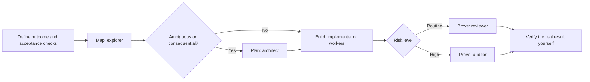

<p align="center"></p>

# Claude Code Agent Team Guide

### Four models. Four moves. One result you can prove.

A field guide to choosing **Claude Fable 5.1, Opus 5.5, Sonnet 5.5 and Haiku 5.5** for each job, plus eight installable Claude Code subagents that pin the right model and effort to every role.

[](SOURCES.md)
[](https://code.claude.com/docs/en/model-config)
[](docs/agents.md)
[](https://github.com/dextee/claude-agent-team-guide/actions/workflows/validate.yml)
[](LICENSE)
[](https://github.com/dextee/claude-agent-team-guide/stargazers)

**Checked against official Anthropic documentation on 15 October 2026.** Model assignments are starting points to test on your own work, not benchmark results. This is an independent guide, not an Anthropic publication.

Maintained by **[Dexter Ng](https://github.com/dextee), CTO & Cybersecurity Lead at [VYR](https://vyrwork.com/about?utm_source=github&utm_medium=referral&utm_campaign=claude_agent_guide&utm_content=guide_author)**. [Explore VYR Agent OS](https://vyrwork.com/agent-os?utm_source=github&utm_medium=referral&utm_campaign=claude_agent_guide&utm_content=guide_intro) · [Work with VYR](WORK_WITH_VYR.md)

## TL;DR

- **Start with Opus 5.5 at `medium` effort.** It is Anthropic's recommended starting point and Claude Code's default on paid plans.
- **Step down** to Sonnet 5.5 for scoped work and Haiku 5.5 for fast, checkable lookups.
- **Step up** to Fable 5.1 when the decision is ambiguous, high-stakes or still failing on Opus at higher effort.
- **Change effort before you change models.** Raise it when evidence shows the task needs more depth.
- **Install eight pinned subagents in one command** and let the main session delegate: map, plan, build, prove.

## Contents

- [Choose in 30 seconds](#choose-in-30-seconds)
- [The Quartet: map, plan, build, prove](#the-quartet-map-plan-build-prove)
- [Your agent team in 60 seconds](#your-agent-team-in-60-seconds)
- [The eight agents](#the-eight-agents)
- [Install options](#install-options)
- [Choose the smallest useful team](#choose-the-smallest-useful-team)
- [Recipes you can use today](#recipes-you-can-use-today)
- [Effort: start at the default, escalate on evidence](#effort-start-at-the-default-escalate-on-evidence)
- [Keep quality and cost visible](#keep-quality-and-cost-visible)
- [Common questions](#common-questions)
- [Part of the Agent Team Guide trilogy](#part-of-the-agent-team-guide-trilogy)
- [See agents work toward a business goal](#see-agents-work-toward-a-business-goal)
- [Apply the approach with VYR](#apply-the-approach-with-vyr)
- [If this helped](#if-this-helped)
- [Sources, artwork and maintenance](#sources-artwork-and-maintenance)

| I want to… | Start here |
|---|---|
| Pick a model for today's task | [24-task selector](docs/task-selector.md) |
| Understand models, effort and prices | [Models and effort](docs/models-and-effort.md) |
| Install and verify the team | [Setup](SETUP.md) |
| Copy a complete workflow prompt | [12 workflow recipes](docs/workflows.md) |
| Use this outside the terminal | [Choose your product](docs/product-surfaces.md) |
| Compare cost per finished task | [Cost and evaluation](docs/cost-and-evaluation.md) |
| Come from the ChatGPT or Kimi guide | [Role mapping across the trilogy](docs/from-chatgpt-and-kimi.md) |
| See business workflows built with agents | [14-workflow atlas](docs/atlas/README.md) |
| Check the evidence | [Sources](SOURCES.md) · [Validation](VALIDATION.md) |

## Choose in 30 seconds

<p align="center"></p>

| Model | Reach for it when… | Example jobs | Input / output, USD per 1M tokens |
|---|---|---|---|
| **Fable 5.1** | The decision is hard, ambiguous or expensive to get wrong | Architecture with conflicting constraints, a pre-release audit, work that still fails on Opus at higher effort | $10 / $50 |
| **Opus 5.5** | You are not sure. This is the default for most real work | Features, debugging, long agentic builds, refactors | $4 / $20 |
| **Sonnet 5.5** | The work is scoped and the instructions are clear | One module, a test file, routine review, research, docs | $2 / $10 |
| **Haiku 5.5** | The job is high-volume, fast and easy to check | Find files, classify, extract fields, route requests | $0.10 / $0.50 for prompts up to 100K tokens |

Anthropic's own guidance: *"If you're unsure which model to use, start with Claude Opus 5.5 for most workloads. Use Claude Fable 5.1 for demanding reasoning and long-horizon agentic work, or when your evals on Claude Opus 5.5 at higher effort still fall short."* ([Models overview](https://platform.claude.com/docs/en/about-claude/models/overview)). Prices are standard Claude API list rates ([pricing](https://platform.claude.com/docs/en/about-claude/pricing)), not subscription allowances. The role assignments in this guide are editorial recommendations.

## The Quartet: map, plan, build, prove

Every task in this guide follows the same four moves. Each move has a default model. Skip a move when it would not change the next action.

| Move | Question it answers | Default agent and model | Skip it when… |
|---|---|---|---|
| **Map** | Where is the relevant evidence? | `explorer` · Haiku 5.5 | You already know the files |
| **Plan** | What is the right approach, and how will we know it worked? | `architect` · Fable 5.1 | Requirements are clear and the change is small |
| **Build** | Make the change and run the checks | `implementer` · Opus 5.5, `worker` · Sonnet 5.5 | Never: this is the work |
| **Prove** | Does the result meet the acceptance checks? | `reviewer` · Sonnet 5.5, `auditor` · Fable 5.1 | The change is trivial and reversible |

**The rule: start in the middle, escalate on evidence.** Opus 5.5 at `medium` leads. Delegate down when the work is clear and checkable. Escalate up when the evidence (a repeated failure, conflicting sources, a costly mistake) says so.

<p align="center"></p>



## Your agent team in 60 seconds

Requires [Claude Code](https://code.claude.com/docs/en/overview) **v2.1.293 or later** (the first release with Haiku 5.5). Check with `claude --version`; upgrade with `claude update`.

**1. Install** the eight agents into your user agents folder. Settings are not touched.

```bash
curl -fsSL https://raw.githubusercontent.com/dextee/claude-agent-team-guide/main/install.sh | bash
```

Prefer to read it first? Download, inspect, then preview:

```bash
curl -fsSLo install.sh https://raw.githubusercontent.com/dextee/claude-agent-team-guide/main/install.sh
less install.sh
bash install.sh --dry-run    # shows every change, writes nothing
```

**2. Open your project** and start a session:

```bash
cd your-project
claude
```

**3. Paste this:**

```text
Use the explorer agent to map the code involved in [feature]. If the design
is unclear, use the architect agent to plan it with acceptance checks. Have
the implementer build it and run the tests, then ask the reviewer to check
the diff against the plan. Report what changed and how it was verified.
```

Run `/tasks` while it works. Claude Code shows the model each subagent is running on ([docs](https://code.claude.com/docs/en/sub-agents)).

## The eight agents

| Agent | Model | Effort | Tools | Job |
|---|---|---|---|---|
| [architect](agents/architect.md) | `claude-fable-5-1` | high | Read-only + web | Plan ambiguous or high-stakes work; return chunks and acceptance checks |
| [implementer](agents/implementer.md) | `claude-opus-5-5` | medium | Full edit + Bash + web | Build the agreed change end to end, with tests |
| [worker](agents/worker.md) | `claude-sonnet-5-5` | medium | Edit + Bash | Own one clearly scoped chunk; run several in parallel |
| [explorer](agents/explorer.md) | `claude-haiku-5-5` | medium | Read, Glob, Grep | Find code fast and return paths with line numbers |
| [reviewer](agents/reviewer.md) | `claude-sonnet-5-5` | high | Read + Bash, no edits | Routine independent review with evidence |
| [auditor](agents/auditor.md) | `claude-fable-5-1` | high | Read + Bash, no edits | Demanding pre-merge or pre-release review |
| [researcher](agents/researcher.md) | `claude-sonnet-5-5` | high | Read-only + web | Gather current sources and flag uncertainty |
| [editor](agents/editor.md) | `claude-sonnet-5-5` | medium | Edit, no Bash | Turn verified material into clear writing |

Each file is a standard Claude Code subagent: YAML frontmatter with `name`, `description`, `model`, `effort` and `tools`, and a system prompt body. The exact model IDs target the Anthropic API. Explicit `tools` lists also stop these agents from spawning their own subagents. Bash is a shell, not a sandbox, so "no edits" on the reviewer and auditor is an instruction, not an enforced permission. [Why each role has this model](docs/agents.md).

## Install options

| Method | Best for | What it changes |
|---|---|---|
| **One-line installer** | Personal setup on macOS, Linux, WSL or Git Bash | Copies eight files into `~/.claude/agents/`; backs up changed files |
| **Project install** | Sharing with a team through git | Copies into `<project>/.claude/agents/` |
| **Claude Code plugin** | Updating with `claude plugin update` | Adds eight namespaced agents such as `agent-team:auditor` |
| **Ask Claude** | Guided setup on a new machine | Claude follows [SETUP.md](SETUP.md) and shows each step |

```bash
# Clone, preview, install (user scope)
git clone https://github.com/dextee/claude-agent-team-guide.git
cd claude-agent-team-guide
bash install.sh --dry-run
bash install.sh

# Project scope, committed with your repository
bash install.sh --project /path/to/your/project

# Plugin route
claude plugin marketplace add dextee/claude-agent-team-guide
claude plugin install agent-team@dextee-guides
```

Choose one method so you do not load two copies. To remove the installer's files, run `bash install.sh --uninstall`, or without a clone `curl -fsSL https://raw.githubusercontent.com/dextee/claude-agent-team-guide/main/install.sh | bash -s -- --uninstall`. Files you edited are kept. [Full setup, verification and rollback](SETUP.md).

## Choose the smallest useful team

| Situation | Suggested arrangement |
|---|---|
| Small, clear edit | One Opus 5.5 session. No subagents |
| Everyday feature | Opus lead; explorer to map; reviewer to check |
| Complex feature or migration | Opus lead; architect first; workers on separate files; auditor last |
| Hard bug | Opus lead at `high`; explorer for evidence; architect if hypotheses compete |
| Research decision | Opus lead; researchers split by question; editor once facts are settled |
| Large mechanical change | Architect splits by file; several workers in parallel; reviewer on the integrated result |
| Release gate | Auditor on the final diff; you verify the real user flow |

Team sizes are hypotheses to test. Every subagent makes its own API requests, so more agents means more tokens. Anthropic recommends subagents for focused jobs where only the result matters, and notes that experimental [agent teams](https://code.claude.com/docs/en/agent-teams) "use significantly more tokens than a single session."

## Recipes you can use today


The [recipe library](docs/workflows.md) has twelve copy-paste prompts: feature delivery, hard bugs, refactors, pre-merge review, security-sensitive changes, research briefs, documentation, release notes, incident triage, dependency upgrades, data reconciliation and cost reduction. Each names the lead, the team, the prompt and what "done" means.

### A better delegation brief

```text
Outcome: [the result required]
Context: [only the files, sources and decisions needed]
Owner: [one agent, one writable area]
Scope: [files, records or questions in and out of scope]
Acceptance: [observable checks]
Return: [result, evidence, unresolved issues, recommended next action]
```

A subagent starts with a fresh context. Only the prompt you pass reaches it, and only its final message comes back ([Agent SDK docs](https://code.claude.com/docs/en/agent-sdk/subagents)). Put everything the agent needs in the brief. [Template](templates/task-brief.md).

## Effort: start at the default, escalate on evidence

In Claude Code, Opus 5.5, Sonnet 5.5 and Haiku 5.5 default to `medium` effort, and Fable 5.1 defaults to `high`. All four accept `low`, `medium`, `high`, `xhigh` and `max` ([model configuration](https://code.claude.com/docs/en/model-config)).

| Start | Work shape | Raise it when… |
|---|---|---|
| `low` | One clear transformation, chat, simple lookups | A needed step or check gets skipped |
| `medium` | Everyday building | Edge cases or dependencies keep being missed |
| `high` | Investigation, review, hard decisions | A reproduced failure still persists |
| `xhigh` / `max` | Long-horizon or frontier problems | A side-by-side comparison shows a better finished result |

Anthropic's advice: *"Tuning effort is often a better lever than switching models"* ([choosing a model](https://platform.claude.com/docs/en/about-claude/models/choosing-a-model)). Set effort with `/effort`, `claude --effort high`, or the `effort` field in an agent file. The `CLAUDE_CODE_EFFORT_LEVEL` environment variable overrides all of these, including agent files. [Effort details](docs/models-and-effort.md).

## Keep quality and cost visible

- Judge the finished task: correctness, rework, elapsed time and billed usage. A confident summary is not evidence.
- Start with one agent when the work is short or sequential.
- Escalate on a trigger: unclear requirements, conflicting evidence, repeated failure or a costly consequence.
- Check `/usage` during long sessions. Subagents draw on the same plan or API budget.
- **Fable may bill usage credits on some plans.** Interactive sessions ask first. In non-interactive `claude -p` runs, Claude Code does not ask ([model configuration](https://code.claude.com/docs/en/model-config)).

Use the [evaluation worksheet](templates/evaluation.csv) and [cost guide](docs/cost-and-evaluation.md). API list prices and subscription limits are different measures.

## Common questions

**Do I need all eight agents?** No. Most tasks need one session and maybe an explorer and a reviewer. Keep the others for the tasks that need them.

**Does `/model` change my agents' models?** No. These agents pin their model in frontmatter, which outranks `/model` and `CLAUDE_CODE_SUBAGENT_MODEL`. Two things do override it: a model Claude passes when it spawns the agent, and `CLAUDE_CODE_SUBAGENT_MODEL_FORCE=1` ([subagent docs](https://code.claude.com/docs/en/sub-agents)). Check `/tasks`.

**Why not Fable for everything?** It costs 2.5× Opus 5.5 per token and is slower. Anthropic positions Opus 5.5 as the starting point and Fable for demanding work. Measure whether the extra cost changes your result.

**Why Haiku for the explorer, not the built-in Explore agent?** The built-in Explore agent generally runs on your main conversation's model (when the main model is Fable, it depends on how you connect). Pinning Haiku 5.5 makes search cheaper. Use whichever you prefer.

**My account has no Fable access.** Change `model: claude-fable-5-1` to `model: claude-opus-5-5` in `architect.md` and `auditor.md`, and raise their `effort` to `high` or `xhigh` if you need more depth.

**I use Amazon Bedrock, Google Cloud or Microsoft Foundry.** Model aliases map to different versions there, and fast mode and the advisor are not available on those providers. Check that each pinned model is enabled for your account. [Product surfaces](docs/product-surfaces.md).

**I installed the earlier edition.** The original guide lived at `dextee/claude-code-agent-team-guide`, now the VYR showcase. This repository replaces it: Sonnet 5 → Sonnet 5.5, Haiku 4.5 → Haiku 5.5, five agents → eight. [Changelog](CHANGELOG.md).

## Part of the Agent Team Guide trilogy

One role spine (architect, implementer, worker, explorer, reviewer, auditor), adapted to three ecosystems.

| Guide | Models covered | Agent format |
|---|---|---|
| **Claude Code Agent Team Guide** (this repo) | Fable 5.1 · Opus 5.5 · Sonnet 5.5 · Haiku 5.5 | Markdown subagents with pinned model and effort |
| [ChatGPT Agent Team Guide](https://github.com/dextee/chatgpt-agent-team-guide) | GPT-6 Astra · GPT-6.1 Sol · GPT-6 Luna | Codex TOML custom agents |
| [Kimi Agent Team Guide](https://github.com/dextee/kimi-agent-team-guide) | K3 · K3 256K · K2.8 Preview · K2.7 Code HighSpeed | Kimi Code Markdown agents and a model pool |

Moving between them? [Role and lever mapping across the trilogy](docs/from-chatgpt-and-kimi.md). The three guides make no claim that models from different vendors are equivalent.

## See agents work toward a business goal

The [Agent Workflow Atlas](docs/atlas/README.md) maps all 14 workflows on [VYR Agent OS](https://vyrwork.com/agent-os?utm_source=github&utm_medium=referral&utm_campaign=claude_agent_guide&utm_content=atlas_intro) into collaboration diagrams, handoff contracts, human decisions and fictional worked examples. It preserves VYR's labels: 3 live, 1 demo, 10 built for you. The [build playbook](docs/atlas/BUILD_PLAYBOOK.md) shows how this repository's agents help implement one.

## Apply the approach with VYR

This guide is free under the MIT license. VYR also scopes and builds agent workflows for businesses. Share the recurring task, current tools, monthly volume, budget range and target start date. **[See the process and send a workflow brief](WORK_WITH_VYR.md)** · [Current Agent OS status](https://vyrwork.com/agent-os?utm_source=github&utm_medium=referral&utm_campaign=claude_agent_guide&utm_content=guide_business)

The model recommendations are not evidence of VYR customer outcomes or an Anthropic endorsement of VYR.

## If this helped

**Star the repository** so other teams can find it, and share the [30-second table](#choose-in-30-seconds) with whoever picks models on your team. Found something out of date? [Open an issue](https://github.com/dextee/claude-agent-team-guide/issues/new/choose) with the official source. [Contributing](CONTRIBUTING.md) · [Cite this guide](CITATION.cff)

## Sources, artwork and maintenance

Every model ID, price, effort setting, frontmatter field, plugin command and CLI flag was checked against official Anthropic documentation on **15 October 2026**. See the [source register](SOURCES.md) and [validation report](VALIDATION.md). Availability varies by plan, provider and Claude Code version, and can change after that date.

Illustrations are conceptual artwork, not product screenshots or measured results. [Gallery and provenance](assets/README.md).

**Independent guide, not an Anthropic publication.** Not affiliated with or endorsed by Anthropic. Claude and its model names are trademarks of Anthropic. [MIT license](LICENSE).
