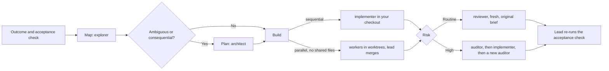

<p align="center"></p>

# Claude Code Agent Team Guide

[Install version 3.0.0](SETUP.md#install-the-tagged-release) · [Try two named subagents](#try-two-named-subagents) · [Inspect verification](VALIDATION.md)

How to split work across subagents, hand it off, run it in parallel without collisions, and prove the result, plus eight installable agents that pin the right model (Fable 5.2, Opus 5.5, Sonnet 5.5, Haiku 5.5) and effort to each role.

[](SOURCES.md)
[](https://code.claude.com/docs/en/model-config)
[](docs/agents.md)
[](https://github.com/dextee/claude-agent-team-guide/actions/workflows/validate.yml)
[](LICENSE)
[](https://github.com/dextee/claude-agent-team-guide/stargazers)

**Checked against official Anthropic documentation on 15 November 2026.** Team designs and model assignments are starting points to test on your own work, not benchmark results. This is an independent guide, not an Anthropic publication.

Maintained by **[Dexter Ng](https://github.com/dextee), CTO & Cybersecurity Lead at [VYR](https://vyrwork.com/about?utm_source=github&utm_medium=referral&utm_campaign=claude_agent_guide&utm_content=guide_author)**. [Explore VYR Agent OS](https://vyrwork.com/agent-os?utm_source=github&utm_medium=referral&utm_campaign=claude_agent_guide&utm_content=guide_intro) · [Work with VYR](WORK_WITH_VYR.md)

## TL;DR

- **Default to one session.** Delegate when a subagent keeps noise out of the lead's context, runs independent work in parallel, or puts a cheaper model on checkable work. [When to delegate](docs/when-to-delegate.md).
- **Subagents start in the background** and report through a completion notification in a later turn. Only their final message comes back. [How subagents run](docs/how-subagents-run.md).
- **Brief in, evidence out.** Give each ordinary subagent the decisions and source paths it needs. Ask it to return evidence. [Handoff contracts](docs/handoff-contracts.md).
- **Parallel writers get their own git worktree**, and the lead integrates. [Parallel work](docs/parallel-work-and-worktrees.md).
- **The verifier is never the implementer**, never a fork, and gets the original brief. [Three-stage audit loop](docs/orchestration-patterns.md#pattern-5-three-stage-audit-loop).
- **Start on Opus 5.5 at `medium`**, step down for checkable work, step up to Fable 5.2 on evidence. [Models and effort](docs/models-and-effort.md).

## Contents

- [Try two named subagents](#try-two-named-subagents)
- [Ten-minute path](#ten-minute-path)
- [Six rules for a team you can trust](#six-rules-for-a-team-you-can-trust)
- [The guide, chapter by chapter](#the-guide-chapter-by-chapter)
- [The eight agents](#the-eight-agents)
- [Choose a model in 30 seconds](#choose-a-model-in-30-seconds)
- [Patterns at a glance](#patterns-at-a-glance)
- [Install options](#install-options)
- [Cost and limits on one screen](#cost-and-limits-on-one-screen)
- [Common questions](#common-questions)
- [Part of the Agent Team Guide trilogy](#part-of-the-agent-team-guide-trilogy)
- [Sources, artwork and maintenance](#sources-artwork-and-maintenance)

## Try two named subagents

Requires [Claude Code](https://code.claude.com/docs/en/overview) **v2.1.321 or later**. Check your version with `claude --version`.

**1. Try the plugin in a fresh session.** From a terminal, clone this guide and load its agents for this session only:

```bash
git clone --branch v3.0.0 --depth 1 https://github.com/dextee/claude-agent-team-guide.git
cd claude-agent-team-guide
claude --plugin-dir .
```

**2. Give the agents different questions.** Paste this inside Claude Code:

```text
Use two subagents in parallel. Ask agent-team:explorer to read
agents/explorer.md and quote its tools field. Ask agent-team:reviewer to
read .github/workflows/validate.yml and quote its first run command.
Use only those files. No edits, shell or web. Wait for both agents.
Return each agent's name, file path and exact quote.
```

**3. Check the handoff.** Look for **two named delegations** in the session; a correct answer from the lead alone does not count. Use `/tasks` while they run to inspect their models. Then open [the explorer definition](agents/explorer.md) and [the workflow](.github/workflows/validate.yml). The returned lines should be `tools: Read, Glob, Grep` and `run: python3 scripts/validate.py`. If a name is missing, select the qualified role from the `@` picker and rerun its question. [Official subagent reference](https://code.claude.com/docs/en/sub-agents).


This is a delegation exercise; for two simple lookups in real work, one session usually suffices. For your own project, pick an [install option](#install-options) and try a [workflow recipe](docs/workflows.md).

## Ten-minute path

Requires [Claude Code](https://code.claude.com/docs/en/overview) **v2.1.321 or later** (the first release with Fable 5.2). Check with `claude --version`; upgrade with `claude update`.

**1. Install** the eight agents into your user agents folder. Settings are not touched.

```bash
curl -fsSL https://raw.githubusercontent.com/dextee/claude-agent-team-guide/main/install.sh | bash
```

Prefer to read it first? `curl -fsSLo install.sh <same URL>`, read it, then `bash install.sh --dry-run`.

**2. Open your project** with `claude`, and **3. paste this:**

```text
Task: [change]. Acceptance check: [command or behavior].
Use the explorer agent to find the files and tests involved. If the
approach is unclear, use the architect agent to plan it and show me the
plan. Have the implementer build it and run the tests, returning the real
command output. Then start the reviewer fresh with my task and the diff,
not the implementer's summary. Wait for every report, then re-run the
acceptance check yourself and show me the output.
```

**4. Watch** `/tasks` while it works: it lists each subagent and its model. **5. Verify** the result yourself. [The full walkthrough](docs/start-here.md).

## Six rules for a team you can trust

1. **One owner per file.** Parallel writers get separate worktrees; shared files are done in sequence.
2. **Fresh context per role.** An ordinary subagent receives its role, brief and applicable project context. Include the decisions and acceptance checks it needs.
3. **Brief in, evidence out.** Every report ends with status, evidence per claim and the real output of the checks it ran. [Return contract](templates/return-contract.md).
4. **The verifier is not the implementer.** Reviewers and auditors are fresh subagents given the original requirements and the artifact, not a summary.
5. **Escalate on evidence.** Raise effort, then the model, after a reproduced failure, conflicting evidence or a costly consequence.
6. **The lead re-runs the proof.** A report is a claim. The acceptance check, run after the reports arrive, is the evidence.

## The guide, chapter by chapter

| # | Chapter | What it answers |
|---|---|---|
| 0 | [Start here](docs/start-here.md) | One task end to end in ten minutes |
| 1 | [When to delegate](docs/when-to-delegate.md) | When a subagent helps, when it doesn't, and the smallest useful team |
| 2 | [How subagents run](docs/how-subagents-run.md) | Background by default, notifications, final-message handback, forks, `SendMessage`, resume, limits |
| 3 | [Agent files](docs/agents.md) | The eight roles and every frontmatter field, verified |
| 4 | [Orchestration patterns](docs/orchestration-patterns.md) | Map-then-act, fan-out, pipeline, parallel writers, three-stage audit loop, competing hypotheses |
| 5 | [Handoff contracts](docs/handoff-contracts.md) | What goes in a brief, what comes back, what the lead re-checks |
| 6 | [Parallel work and worktrees](docs/parallel-work-and-worktrees.md) | `isolation: worktree`, the base-branch trap, the integration step |
| 7 | [Models and effort](docs/models-and-effort.md) · [Task selector](docs/task-selector.md) | Which model and effort for which role and task |
| 8 | [Cost, limits and evaluation](docs/cost-and-evaluation.md) | Where tokens go, caps on depth, concurrency and spend, measuring cost per accepted result |
| 9 | [Gates and hooks](docs/gates-and-hooks.md) | `SubagentStop` and other hooks as gates; proving a gate can fail |
| 10 | [Failure modes](docs/failure-modes.md) | Correlated agreement, anchoring, trusted summaries, gates that can't fail, blocked pages, partial output |
| 11 | [Recipes](docs/workflows.md) | Twelve jobs, each with a prompt and a proof line |
| 12 | [Product surfaces and providers](docs/product-surfaces.md) | CLI, IDEs, desktop, web, Agent SDK, Bedrock, Google Cloud, Foundry |
| 13 | [Agent teams](docs/agent-teams.md) | The experimental heavier option, and when it beats subagents |
| 14 | [From the ChatGPT and Kimi guides](docs/from-chatgpt-and-kimi.md) | Role and lever mapping across the trilogy |

## The eight agents

<p align="center"></p>

| Agent | Model | Effort | Tools | Job |
|---|---|---|---|---|
| [architect](agents/architect.md) | `claude-fable-5-2` | high | Read-only + web | Plan ambiguous or high-stakes work; return chunks that share no files, with acceptance checks |
| [implementer](agents/implementer.md) | `claude-opus-5-5` | medium | Full edit + Bash + web | Build the agreed change end to end, in your checkout, with tests |
| [worker](agents/worker.md) | `claude-sonnet-5-5` | medium | Edit + Bash, own git worktree | Own one chunk; run several in parallel; commit and report the branch |
| [explorer](agents/explorer.md) | `claude-haiku-5-5` | medium | Read, Glob, Grep | Find code fast and return paths with line numbers |
| [reviewer](agents/reviewer.md) | `claude-sonnet-5-5` | high | Read + Bash, instructed to avoid edits | Routine independent review with evidence |
| [auditor](agents/auditor.md) | `claude-fable-5-2` | high | Read + Bash, instructed to avoid edits | Demanding review; never relies on the implementer's account |
| [researcher](agents/researcher.md) | `claude-sonnet-5-5` | high | Read-only + web | Gather current sources and flag uncertainty |
| [editor](agents/editor.md) | `claude-sonnet-5-5` | medium | Edit, no Bash | Turn verified material into clear writing |

None of them can spawn subagents (no `Agent` tool), so the lead owns every handoff. The worker runs with `isolation: worktree` and `maxTurns: 40`; the explorer starts without CLAUDE.md. Bash is a shell, not a sandbox, so "no edits" on the reviewer and auditor is an instruction, not an enforced permission; see [gates and hooks](docs/gates-and-hooks.md). [Every frontmatter field, verified](docs/agents.md).

## Choose a model in 30 seconds

<p align="center"></p>

| Model | Reach for it when… | Example jobs | Input / output, USD per 1M tokens |
|---|---|---|---|
| **Fable 5.2** | The decision is hard, ambiguous or expensive to get wrong | Architecture with conflicting constraints, a pre-release audit, work that still fails on Opus at higher effort | $8 / $40 |
| **Opus 5.5** | You are not sure. This is the default for most real work | Features, debugging, long agentic builds, refactors | $4 / $20 |
| **Sonnet 5.5** | The work is scoped and the instructions are clear | One module, a test file, routine review, research, docs | $2 / $10 |
| **Haiku 5.5** | The job is high-volume, fast and easy to check | Find files, classify, extract fields, route requests | $0.10 / $0.50 for prompts up to 100K tokens |

Anthropic's own guidance: *"If you're unsure which model to use, start with Claude Opus 5.5 for most workloads. Use Claude Fable 5.2 for demanding reasoning and long-horizon agentic work, or when your evals on Claude Opus 5.5 at higher effort still fall short."* ([Models overview](https://platform.claude.com/docs/en/about-claude/models/overview)). Prices are standard Claude API list rates ([pricing](https://platform.claude.com/docs/en/about-claude/pricing)), not subscription allowances. Role assignments are this guide's recommendations. Fable 5.1, the previous Fable, remains selectable by ID; see [models and effort](docs/models-and-effort.md#if-you-cannot-run-fable-52).

## Patterns at a glance



Six patterns with copy-paste prompts: [orchestration patterns](docs/orchestration-patterns.md). Twelve jobs: [recipes](docs/workflows.md).


## Install options

| Method | Best for | What it changes |
|---|---|---|
| **One-line installer** | Personal setup on macOS, Linux, WSL or Git Bash | Copies eight files into `~/.claude/agents/`; backs up changed files |
| **Project install** | Sharing with a team through git | Copies into `<project>/.claude/agents/` |
| **Claude Code plugin** | Updating with `claude plugin update` | Adds eight namespaced agents such as `agent-team:auditor` |
| **Ask Claude** | Guided setup on a new machine | Claude follows [SETUP.md](SETUP.md) and shows each step |

```bash
# Clone, preview, install (user scope)
git clone https://github.com/dextee/claude-agent-team-guide.git
cd claude-agent-team-guide
bash install.sh --dry-run
bash install.sh

# Project scope, committed with your repository
bash install.sh --project /path/to/your/project

# Plugin route
claude plugin marketplace add dextee/claude-agent-team-guide
claude plugin install agent-team@dextee-guides
```

Choose one method so you do not load two copies. To remove the installer's files, run `bash install.sh --uninstall`, or without a clone `curl -fsSL https://raw.githubusercontent.com/dextee/claude-agent-team-guide/main/install.sh | bash -s -- --uninstall`. Files you edited are kept. Follow the [tagged release installation](SETUP.md#install-the-tagged-release) for a specific version. [Full setup, verification and rollback](SETUP.md).

## Cost and limits on one screen

- Every subagent sends its own requests against the same plan or API budget. `/usage` attributes recent usage to subagents on subscription plans.
- Results return into the lead's context. Ask for short, structured reports.
- Defaults: three layers of nesting, 20 subagents running at once, no limit on the total. In the Agent SDK, allow headroom for in-flight requests when setting the per-query threshold with `max_budget_usd` / `maxBudgetUsd`.
- Subagent prompt caches last five minutes by default, even on a subscription.
- Agent teams cost the most: each teammate is a full instance.
- **Fable may bill usage credits on some plans.** Interactive sessions ask first. In non-interactive `claude -p` runs, Claude Code does not ask ([model configuration](https://code.claude.com/docs/en/model-config)).

Details and sources: [cost, limits and evaluation](docs/cost-and-evaluation.md).

## Common questions

**Do I need all eight agents?** No. Most tasks need one session and maybe an explorer and a reviewer.

**Why didn't Claude wait for the subagent?** Subagents spawned from the main conversation start in the background, and in interactive sessions fork mode (on by default) stops Claude waiting. The result arrives as a notification in a later turn. [How to make Claude wait](docs/how-subagents-run.md#making-claude-wait).

**Does `/model` change my agents' models?** No. These agents pin their model in frontmatter, which outranks `/model` and `CLAUDE_CODE_SUBAGENT_MODEL`. Two things do override it: a model Claude passes when it spawns the agent, and `CLAUDE_CODE_SUBAGENT_MODEL_FORCE=1` ([subagent docs](https://code.claude.com/docs/en/sub-agents)). Check `/tasks`.

**Why not Fable for everything?** Fable 5.2 costs twice Opus 5.5 per token. Anthropic positions Opus 5.5 as the starting point and Fable for demanding work. Measure whether the extra cost changes your result.

**My Claude Code is older than 2.1.321, or my account has no Fable.** Run `claude update`. Otherwise change `model:` in `architect.md` and `auditor.md` to `claude-fable-5-1` (v2.1.257 or later) or `claude-opus-5-5` with `effort: high` or `xhigh`.

**Workers branched from `main` instead of my branch.** That is the documented default for worktrees. Set `worktree.baseRef` to `"head"` and commit before dispatching. [Parallel work](docs/parallel-work-and-worktrees.md#branch-from-your-work-not-from-main).

**I use Amazon Bedrock, Google Cloud or Microsoft Foundry.** Aliases map to different versions there, and fast mode and the advisor are limited by provider. Check that each pinned model is enabled for your account. [Product surfaces](docs/product-surfaces.md).

**I installed an earlier edition.** See the [changelog](CHANGELOG.md). 3.0.0 moves the architect and auditor to Fable 5.2, isolates the worker in a worktree, and raises the Claude Code minimum.

## Part of the Agent Team Guide trilogy

One role spine (architect, implementer, worker, explorer, reviewer, auditor), adapted to three ecosystems.

| Guide | Models covered | Agent format |
|---|---|---|
| **Claude Code Agent Team Guide** (this repo) | Fable 5.2 · Opus 5.5 · Sonnet 5.5 · Haiku 5.5 | Markdown subagents with pinned model and effort |
| [ChatGPT Agent Team Guide](https://github.com/dextee/chatgpt-agent-team-guide) | GPT-6.2 Astra · GPT-6.2 Sol · GPT-6.1 Terra · GPT-6 Luna | Codex TOML custom agents |
| [Kimi Agent Team Guide](https://github.com/dextee/kimi-agent-team-guide) | K3 · K3 256K · K2.8 Preview · K2.7 Code HighSpeed | Kimi Code Markdown agents and a model pool |

Moving between them? [Role and lever mapping across the trilogy](docs/from-chatgpt-and-kimi.md). The three guides make no claim that models from different vendors are equivalent.

## See agents work toward a business goal

The [Agent Workflow Atlas](docs/atlas/README.md) maps all 14 workflows on [VYR Agent OS](https://vyrwork.com/agent-os?utm_source=github&utm_medium=referral&utm_campaign=claude_agent_guide&utm_content=atlas_intro) into collaboration diagrams, handoff contracts, human decisions and fictional worked examples. It preserves VYR's labels: 3 live, 1 demo, 10 built for you. The [build playbook](docs/atlas/BUILD_PLAYBOOK.md) shows how this repository's agents help implement one.

## Apply the approach with VYR

This guide is free under the MIT license. VYR also scopes and builds agent workflows for businesses. Share the recurring task, current tools, monthly volume, budget range and target start date. **[See the process and send a workflow brief](WORK_WITH_VYR.md)** · [Current Agent OS status](https://vyrwork.com/agent-os?utm_source=github&utm_medium=referral&utm_campaign=claude_agent_guide&utm_content=guide_business)

The recommendations are not evidence of VYR customer outcomes or an Anthropic endorsement of VYR.

## If this helped

**Star the repository** so other teams can find it. Found something out of date? [Open an issue](https://github.com/dextee/claude-agent-team-guide/issues/new/choose) with the official source. [Contributing](CONTRIBUTING.md) · [Cite this guide](CITATION.cff)

## Sources, artwork and maintenance

Every model ID, price, effort setting, frontmatter field, environment variable, plugin command and CLI flag was checked against official Anthropic documentation on **15 November 2026**. Model IDs, rates and minimum versions live in [templates/models.json](templates/models.json), and `scripts/validate.py` checks every page against it. See the [source register](SOURCES.md) and [validation report](VALIDATION.md). Availability varies by plan, provider and Claude Code version, and can change after that date.

Illustrations are conceptual artwork, not product screenshots or measured results. [Gallery and provenance](assets/README.md).

**Independent guide, not an Anthropic publication.** Not affiliated with or endorsed by Anthropic. Claude and its model names are trademarks of Anthropic. [MIT license](LICENSE).
