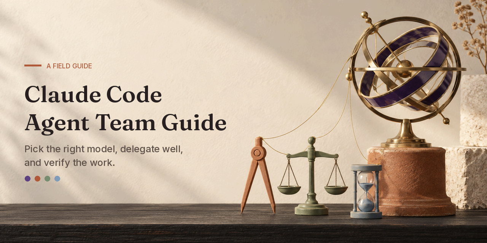

# Artwork gallery and provenance

[Home](../README.md) · [Workflows](../docs/workflows.md) · [Models and effort](../docs/models-and-effort.md)

Eight illustrations and one social card made for this guide. They are conceptual artwork: still lifes of instruments and workspaces that stand for ideas in the guide. They are not product screenshots, measured results or evidence of completed work.

## Provenance

- **Method:** built-in image generation via Codex (ChatGPT login), run with `codex exec`. No API key and no image API script were used.
- **Tool reported:** `image_gen.imagegen`. The tool did not report which image model it used, so the exact model is **unknown**. These images are not claimed as the output of any named model.
- **Text:** the eight illustrations were prompted to contain no words, numbers, logos or brand marks. The lettering on the social card was added afterwards with Pillow, so it is exact.
- **People:** no real people, faces or hands, and no interface screenshots.
- **Date:** 2026-10-15.

[image-manifest.json](image-manifest.json) records the full prompt, dimensions, SHA-256 hash, number of attempts, post-processing and inspection notes for every file.

## Visual language

Warm ivory paper and plaster, terracotta and fired clay, deep charcoal oak and soft brushed gold, in calm late-afternoon light. Each model has one accent colour, used the same way across the set:

| Model | Accent | Instrument |
|---|---|---|
| Fable 5.1 | Violet | Armillary sphere: deepest reasoning |
| Opus 5.5 | Terracotta red | Dividers over an unfinished model: frontier, hard tasks |
| Sonnet 5.5 | Sage green | Balance scale: everyday, balanced work |
| Haiku 5.5 | Sky blue | Small hourglass and index cards: fast, small jobs |

The pairing of model and instrument is this guide's metaphor. It is not a ranking or a capability measurement.

## Gallery

| Team and coordination | Work in practice |
|---|---|
|  |  |
|  |  |
|  |  |
|  |  |

| File | Size (px) | Used for |
|---|---|---|
| `images/hero.png` | 1600 × 900 | README cover |
| `images/model-team.png` | 1774 × 887 | Choosing a model |
| `images/orchestration.png` | 1536 × 1024 | Lead agent and subagents |
| `images/workflow-coding.png` | 1536 × 1024 | Coding workflow |
| `images/workflow-research.png` | 1619 × 971 | Research workflow |
| `images/workflow-review.png` | 1536 × 1024 | Review and verification |
| `images/workflow-docs.png` | 1536 × 1024 | Documentation workflow |
| `images/workflow-ops.png` | 1536 × 1024 | Operations workflow |
| `social-preview.png` | 1280 × 640 | GitHub social card |

## How the images were made

1. **Brief.** Each prompt names the use, the subject, the composition and a shared style block (palette, materials, light) plus a fixed avoid list: no robots, sci-fi, people, screens, logos or text.
2. **Generate.** One `codex exec` call per image, one at a time, asking Codex to use its built-in image tool. Outputs were copied from `~/.codex/generated_images/`.
3. **Inspect.** Every image was opened at full size and cropped where detail mattered, checking for stray text, warped objects, logos, off-palette colour and clutter. Images that failed were regenerated with one targeted change. One of ten generations was rejected: the first model-team image, whose Fable accent read as burgundy rather than violet.
4. **Finish.** The cover was cropped to 16:9. The social card was resized to exactly 1280 × 640 and its text set with Pillow in Fraunces and Inter (SIL Open Font License; the fonts are not included here). Every PNG had its colour depth rounded to 6 bits per channel and was saved optimised, which keeps each file under 1.5 MB with no visible change.
5. **Record.** Hashes and notes were written to the manifest.

To replace an image, follow the same steps, keep the palette and accent colours, update the manifest entry and its hash, and run `python3 scripts/validate.py`.
