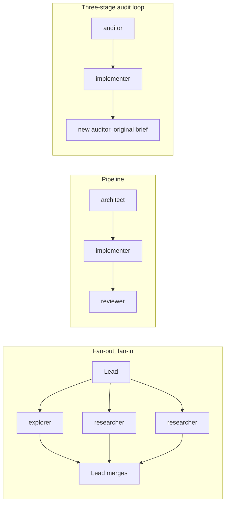

[Home](../README.md) · [How subagents run](how-subagents-run.md) · [Handoff contracts](handoff-contracts.md) · [Recipes](workflows.md)

# Orchestration patterns

Six shapes cover most team work. Each has a copy-paste prompt for the lead session and a line that says what proves it worked. Names refer to [the eight agents](agents.md); with the plugin install, prefix them with `agent-team:`. The patterns are this guide's recommendations. The Claude Code behavior they rely on was checked against the [subagent reference](https://code.claude.com/docs/en/sub-agents) and [agent teams](https://code.claude.com/docs/en/agent-teams) on **15 November 2026**.



Two rules apply to every pattern:

- **The lead owns the handoffs.** None of the eight agents can spawn subagents, so every brief and every result passes through the lead, where you can see it.
- **Subagents start in the background.** The lead must wait for each completion notification before it summarizes. Say so in the prompt. See [how subagents run](how-subagents-run.md#background-by-default-and-completion-notifications).

## Pattern 1. Map, then act

**When:** you don't yet know which files matter. **Shape:** explorer returns paths; the lead reads only those.

```text
Use the explorer agent to find every place that [behavior] is implemented or
tested. Return file paths with line numbers and one line each, nothing else.
Wait for its report. Then read only the files it lists that you need, and
tell me which ones you read and why.
```

**What proves it worked:** the explorer's report lists paths with line numbers, and you can open two of them and find the behavior at the cited line.

**Pitfall:** the explorer starts without CLAUDE.md (`omitClaudeMd: true`). Put path rules ("ignore `vendor/`") in the request.

## Pattern 2. Fan-out, fan-in

**When:** several independent, read-only questions. **Shape:** one subagent per question, in parallel; the lead merges.

```text
Split this into independent questions: [list or "decide"]. Run one
researcher agent per question in parallel. Give each the question, the
criteria, and this return format: answer, sources with dates, open
uncertainties. Wait until every researcher has reported; list any that
failed or returned partial output. Then reconcile conflicts yourself and
give me one table: question, answer, strongest source, confidence.
```

**What proves it worked:** the merged table has one row per question, every row cites a source you can open, and the lead names any researcher that failed instead of silently dropping it.

**Pitfalls:** every report lands in the lead's context, so ask for short returns. Fan-out is for reads. For parallel *writes*, use Pattern 4.

## Pattern 3. Pipeline

**When:** ordered stages where each needs the last one's output: plan, build, check. **Shape:** architect → implementer → reviewer, with the lead passing a brief between stages.

```text
Use the architect agent to plan [change]: chunks, files each chunk owns,
acceptance checks, and risks. Wait for the plan and show it to me before
building. After I approve, give the implementer the plan and the acceptance
checks verbatim, and have it build and run the tests. Then give the reviewer
the original request, the plan and the diff (not the implementer's summary)
and ask for findings with file and line evidence.
```

**What proves it worked:** each stage's brief contains the previous stage's actual output (plan text, diff), not a paraphrase, and the reviewer's findings cite lines in the diff.

**Pitfall:** passing summaries down the chain loses detail at each step. Pass artifacts: the plan, the diff, the test output.

## Pattern 4. Parallel writers in worktrees

**When:** a large change that splits into chunks with **no shared files**. **Shape:** architect splits; workers run in parallel, each in its own git worktree; the lead integrates and runs the full suite.

```text
Commit my current changes first and tell me the commit SHA. Use
the architect agent to split [change] into chunks that share no files; for
each chunk give the files it owns and its verification command. Then run
one worker agent per chunk in parallel. Give each worker the base commit
SHA, its chunk, its files and its check. Wait for all of them. For each,
record the branch and commit it reports. Merge the branches into my branch
one at a time, stop on the first conflict, then run the full test suite
and show me the output.
```

**What proves it worked:** every worker reports a branch and commit on the base SHA you gave it, the merges apply in order, and the full suite passes on the integrated result, not just per chunk.

**Before you run it:** worker worktrees branch from your **default branch**, not your current `HEAD`, unless `worktree.baseRef` is `"head"` in your settings. If you work on a feature branch, set it first, or every worker will report a base mismatch and stop (that check is in the worker's instructions on purpose). Details and the integration step: [parallel work and worktrees](parallel-work-and-worktrees.md).

## Pattern 5. Three-stage audit loop

**When:** consequential work: security, data handling, migrations, public APIs, releases. **Shape:** an auditor finds problems; an implementer fixes them; a **different, fresh** auditor verifies the result against the **original brief**.

```text
Stage 1: use the auditor agent to review [target] against this brief:
[paste the original requirements]. Findings need file and line evidence or
a command and its output. Wait for its report and show it to me.

Stage 2: give the implementer the brief and the findings I accept. It fixes
them, runs the checks, and returns the diff and the command output.

Stage 3: start a NEW auditor agent (not a resume of the first, not a fork).
Give it only: the original brief, the list of accepted findings, the
current diff, and the commands to reproduce. Do not give it the
implementer's summary or the first auditor's reasoning. Ask it to verify
each finding is fixed and to look for anything the fix broke.
```

**What proves it worked:** the stage-3 auditor is a new agent ID, its brief contains the original requirements and no implementer summary, and every accepted finding is marked fixed with evidence it produced itself (a command it ran, a line it read).

**Why a different, fresh auditor:** a resumed auditor or a fork carries its own earlier reasoning, and an auditor fed the implementer's summary reviews the summary instead of the work. Agreement between them is then not independent evidence. See [failure modes](failure-modes.md).

## Pattern 6. Competing hypotheses

**When:** a bug or decision with several plausible explanations. **Shape:** one investigator per hypothesis, each also trying to disprove the others; the lead adjudicates on evidence.

```text
Users report [symptom]. List the plausible causes. For each, start a
separate explorer or general-purpose subagent with: the symptom, the
reproduction, its hypothesis, and the instruction to find evidence that
would confirm OR rule it out. Wait for all of them. Then show me a table:
hypothesis, evidence for, evidence against, verdict. Fix nothing until one
cause predicts the failure and the others are ruled out.
```

**What proves it worked:** the surviving hypothesis predicts the observed failure, and each rejected one has a specific piece of evidence against it, not just a lack of evidence for it.

Anthropic's agent-teams guide describes the reason for this shape: *"Sequential investigation suffers from anchoring: once one theory is explored, subsequent investigation is biased toward it."* With agent teams enabled, teammates can also message each other to challenge findings directly; see [agent teams](agent-teams.md).

---

*Independent guide, not an Anthropic publication; not affiliated with or endorsed by Anthropic. Product facts checked 2026-11-15 against the pages in [SOURCES.md](../SOURCES.md).*
