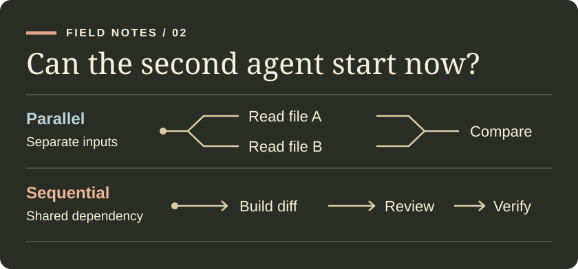

[Home](../README.md) · [Orchestration patterns](orchestration-patterns.md) · [Task selector](task-selector.md) · [Delegation template](../templates/task-brief.md)

# Twelve recipes with useful handoffs

These recipes apply the [orchestration patterns](orchestration-patterns.md) to common jobs, using [the eight installed agents](agents.md). Each has a lead, a team, a copy-paste prompt, and a line that says what proves it worked. With the plugin install, prefix agent names with `agent-team:`, for example `agent-team:reviewer`. Outside Claude Code, run the stages one after another ([product surfaces](product-surfaces.md)).

Every prompt assumes two things from [how subagents run](how-subagents-run.md): subagents start in the background, so the lead must wait for their reports; and each subagent sees only its brief, so the prompt says what to pass. Ask every agent to end with the [return contract](../templates/return-contract.md).

Illustrations are conceptual artwork, not screenshots or evidence of completed work. [Provenance](../assets/README.md).



Give each independent task its own question or files. When one task needs another’s result, pass the finished artifact and its acceptance checks to the next agent.

## 1. Deliver a feature


**Lead:** Opus 5.5 / medium. **Team:** explorer, implementer, reviewer; architect only if the design is unresolved. **Pattern:** [pipeline](orchestration-patterns.md#pattern-3-pipeline).

```text
Build [feature]. Success means [observable behavior].
Use the explorer agent to find the responsible files and existing tests.
If the approach is unclear, use the architect agent to plan it with
acceptance checks. Have the implementer build it and run the tests. Then
give the reviewer the request, the plan and the diff (not the
implementer's summary). Fix material findings. Wait for every report, then
re-run the tests yourself and show me the output.
```

**What proves it worked:** the requested behavior works when you run it, nearby tests still pass in your own run, and the reviewer's findings cite lines in the final diff. A passing build alone does not show the user flow works.

## 2. Investigate a hard bug

**Lead:** Opus 5.5 / high. **Team:** explorers, one per hypothesis; architect when hypotheses compete. **Pattern:** [competing hypotheses](orchestration-patterns.md#pattern-6-competing-hypotheses).

```text
Investigate [failure]. Reproduction: [steps]. Expected: [behavior].
Separate observations from hypotheses. For each plausible cause, start a
separate explorer to collect evidence that would confirm or rule it out.
Wait for all of them. If two or more remain plausible, ask the architect
which evidence would distinguish them. Fix only the proven cause. Show the
reproduction now passes and check the closest regression.
```

**What proves it worked:** the reproduction fails before the fix and passes after, the cause explains why the failure happened, and each rejected hypothesis has specific evidence against it.

## 3. Run a large refactor

**Lead:** Opus 5.5 / medium. **Team:** architect splits; workers in their own worktrees; reviewer on the integrated result. **Pattern:** [parallel writers in worktrees](orchestration-patterns.md#pattern-4-parallel-writers-in-worktrees).

```text
Refactor [area] while preserving [public behavior]. Commit my current work
and record HEAD as the base SHA; confirm worktree.baseRef is "head".
Use the architect agent to split the work into chunks with no shared
files. Run one worker agent per chunk in parallel, each given the base
SHA, its files and its check. Wait for every worker; list each branch and
commit. Merge them one at a time with --no-ff, stop on the first conflict,
run the full test suite, then ask the reviewer to check the combined diff
against the original request.
```

**What proves it worked:** the merged state passes the full suite in your own run, no file appears in two workers' diffs, and `git log --graph` shows each worker's commit on the base SHA. Separate chunk checks do not prove the integrated result works. [Parallel work and worktrees](parallel-work-and-worktrees.md).

## 4. Review before merge


**Lead:** Opus 5.5 / medium. **Team:** reviewer for routine changes; auditor for consequential ones.

```text
Review [branch or PR] against [requirements]. Give the reviewer agent the
requirements and the diff, nothing else. If the change touches
authentication, payments, data deletion, migrations or public APIs, use the
auditor agent instead. Report only findings with a file and line or a
reproducing command. Then list which requirements were verified and which
were not checked.
```

**What proves it worked:** every requirement is listed as verified (with evidence) or not checked, and every finding has a location you can open. "No issues found" is not the same as full coverage.

## 5. Ship a security-sensitive change

**Lead:** Opus 5.5 / high. **Team:** architect states threat assumptions; implementer builds; auditor reviews; a second, fresh auditor verifies. **Pattern:** [three-stage audit loop](orchestration-patterns.md#pattern-5-three-stage-audit-loop).

```text
Change [component] to [goal]. First, use the architect agent to list the
threat assumptions, trust boundaries and abuse cases, with a test for each.
Have the implementer build the change and those tests. Use the auditor
agent to review the diff against the threat list. Have the implementer fix
accepted findings. Then start a NEW auditor (not a resume, not a fork) with
only the threat list, the accepted findings, the final diff and the test
commands, and have it verify each fix.
```

**What proves it worked:** every listed abuse case has a passing test you can run, the second auditor is a different agent ID whose brief contains no implementer summary, and it marks each finding fixed with its own evidence. An AI review is not a substitute for a human security review where your policy requires one.

## 6. Produce a research decision brief


**Lead:** Opus 5.5 / high. **Team:** researchers split by question, then the editor. **Pattern:** [fan-out, fan-in](orchestration-patterns.md#pattern-2-fan-out-fan-in).

```text
Research [decision] for [audience], judged on [criteria]. Split it into
independent questions and run one researcher agent per question in
parallel. Each must return dated primary sources and mark inferences.
Wait for all of them and list any that failed. Reconcile conflicts
yourself. Then have the editor agent write a one-page brief:
recommendation, strongest alternative, and what evidence would change the
choice.
```

**What proves it worked:** each criterion is covered, you can open the source behind each key claim and find the claim there, and the brief separates evidence from inference.

## 7. Write documentation from the code


**Lead:** Sonnet 5.5 / medium, or Opus 5.5 for large systems. **Team:** explorer, then editor.

```text
Write [README / setup guide / API reference] for [audience]. Use the
explorer agent to collect the real commands, configuration keys, defaults
and file paths, with file and line for each. Have the editor agent write
from that evidence only. As lead, run every command in the document that is safe to
run, and list any you could not verify.
```

**What proves it worked:** every command and setting in the document traces to a file and line the explorer cited, and the safe commands were run with their output shown.

## 8. Prepare release notes

**Lead:** Sonnet 5.5 / medium. **Team:** the lead gathers git history; explorer reads changed files; editor writes.

```text
Draft release notes for [version] from [base ref] to [head]. Run
`git log --oneline [base]..[head]` and `git diff --stat [base]..[head]`
yourself. Pass the output to the explorer agent and have it read the
changed files to group changes as features, fixes, breaking changes and
security. Have the editor agent write user-facing notes. Mark any change
whose impact you could not confirm from the code.
```

The explorer has Read, Glob and Grep only, so it cannot run git. The lead runs commands and hands over the output.

**What proves it worked:** every line in the notes maps to a commit in the log you ran, and each breaking change includes its migration step.

## 9. Triage an incident


**Lead:** Opus 5.5 / high. **Team:** explorer for code and config in the repo; reviewer for read-only commands; one owner for remediation.

```text
Users report [symptom] since [time]. The exported logs are at [local path].
Have the explorer read that snapshot and the local config at [paths].
In parallel, have the reviewer run `git log --since="[time]" -- [paths]`
in the local checkout. Combine their evidence into a timeline. Identify
the likely cause, what would disprove it, and a proposed mitigation.
If the export is missing, report the gap. Do not access production.
List any proposed live checks or changes for the incident owner.
```

**What proves it worked:** each timeline entry cites a log line or commit, the proposed cause explains the start time, and nothing ran against production before your approval.

## 10. Upgrade a dependency

**Lead:** Opus 5.5 / medium. **Team:** researcher reads the upgrade notes; explorer finds call sites; implementer upgrades; reviewer checks.

```text
Upgrade [package] from [old] to [new]. Use the researcher agent to collect
the official migration notes and breaking changes. Use the explorer agent
to find every affected call site. Wait for both. Have the implementer make
the upgrade and fix breakages, then run the full test suite. Ask the
reviewer to check for behavior changes the tests would not catch.
```

**What proves it worked:** build and tests pass in your own run, and each breaking change in the official notes is either handled at a cited call site or shown not to apply.

## 11. Reconcile data or invoices

**Lead:** Sonnet 5.5 / high. **Team:** Haiku extraction for clean fields; Opus 5.5 if definitions conflict.

```text
Reconcile [source A] and [source B]. Keep the originals unchanged. State
the matching keys and definitions. Separate confirmed matches, duplicates,
missing records and unresolved differences. Recalculate totals from the
underlying records. Explain every remaining difference; never treat
missing data as zero.
```

**What proves it worked:** totals recalculated from the records match, or every difference is listed with its cause. A formatted spreadsheet is not the verification.

## 12. Cut the cost of a recurring workflow

**Lead:** Opus 5.5 / medium for evaluation design. **Candidate:** Sonnet 5.5 or Haiku 5.5 at lower effort.

```text
Compare [current route] with [cheaper route] on the same [N] representative
cases. Write acceptance checks before running. Record pass or fail,
retries, elapsed time and token usage for each case. Keep the cheaper
route only if it meets the quality bar, and define which cases must still
go to the stronger model.
```

**What proves it worked:** the choice rests on measured, completed-task results for the same cases, including the failures. Include the current model at a lower effort as one candidate; Anthropic notes that tuning effort is often a better lever than switching models. [Evaluation worksheet](../templates/evaluation.csv) · [Cost and limits](cost-and-evaluation.md).

---

*Independent guide, not an Anthropic publication; not affiliated with or endorsed by Anthropic. Product facts checked 2026-11-15 against the pages in [SOURCES.md](../SOURCES.md).*
